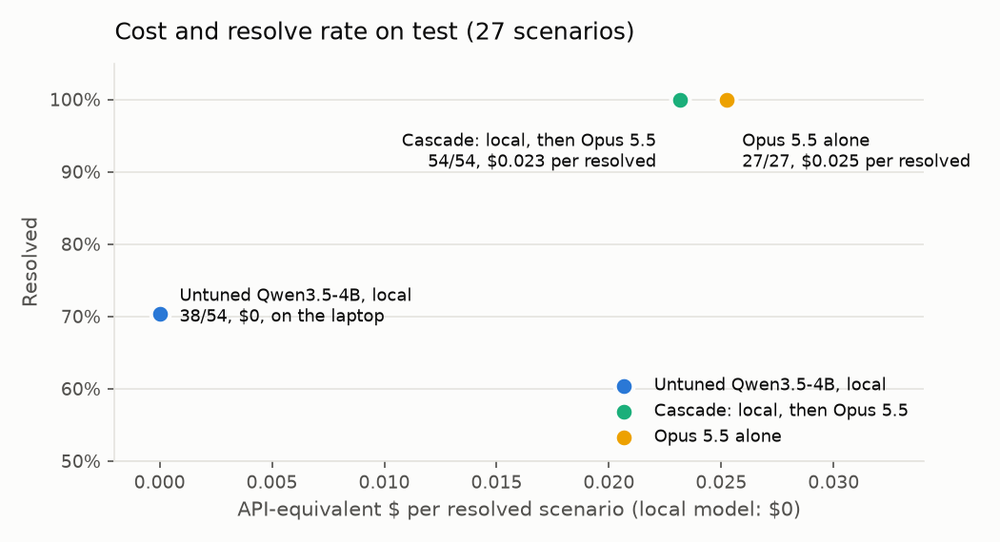
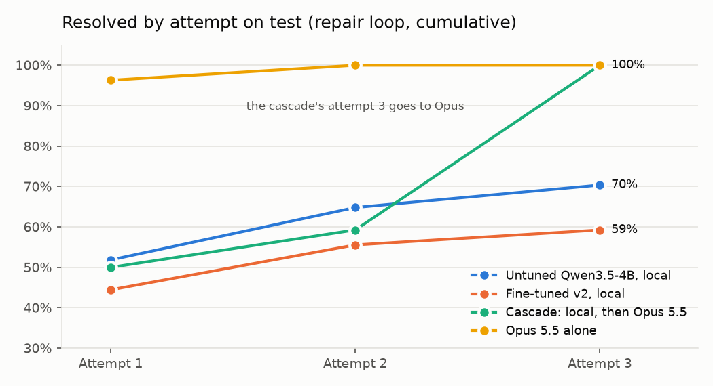
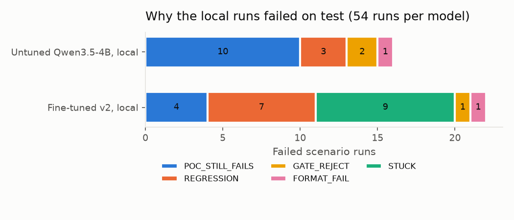

# AeroPatch

AeroPatch asks how much automated vulnerability remediation a 4B model on a 4 GB laptop GPU can
do. It fixes Python vulnerabilities locally, proves each fix in a network-less sandbox, retries
with test feedback, and escalates to a frontier model only when needed. Every claim is measured
on a contamination-controlled benchmark.

Status: **complete (2026-10-16)**: four weeks, final runs, security checklist and
[write-up](docs/writeup.md) done ([plan](docs/14-timeline-part5.md), [NOTES.md](NOTES.md)).
Outputs are **candidate fixes that need human review**.

## Results

The headline in one line: the untuned 4B model fixes 70% of the hand-built test scenarios and
35% of the real CVEs on its own at no API cost; a cascade that hands its third attempt to Claude
Opus 5.5 fixes 100% and 90%. Fine-tuning it did not help (59% and 15%).

Resolved, with up to three attempts and test feedback between them. Local rows and the cascade
are two runs pooled, so 27 scenarios count 54 times; 95% Wilson intervals in brackets.

| Model | Test, 27 hand-built (Tier A) | 10 real CVEs (Tier B) | 5 held-out synthetic (Tier C) |
|---|---|---|---|
| Qwen3.5-4B untuned, local, $0 | **38/54, 70%** [57–81] | **7/20, 35%** [18–57] | 9/10, 90% [60–98] |
| Qwen3.5-4B fine-tuned (v2), local, $0 | 32/54, 59% [46–71] | 3/20, 15% [5–36] | 9/10, 90% [60–98] |
| Cascade: local, local, then Opus 5.5 | **54/54, 100%** [93–100] | **18/20, 90%** [70–97] | 10/10, 100% [72–100] |
| Claude Opus 5.5 alone | 27/27, 100% [88–100] | 10/10, 100% [72–100] | 5/5, 100% [57–100] |

- **The cascade resolves 32 of its 54 test runs without a frontier call**, and costs $0.023 per
  resolved scenario against $0.025 for Opus alone (API-equivalent; both ran on a Claude Code
  subscription, so nothing was billed per token). On the real CVEs both cost $0.038: the
  escalation sends the whole attempt history, which eats most of the saving.
- **The cascade misses one real CVE in both runs** (`B-400-02`): its single Opus attempt breaks
  a regression test, where Opus alone fixes it with feedback on attempt 2.
- **Paired differences** (run *i* against run *i*, 95% paired bootstrap interval, exact
  McNemar): on test, untuned → fine-tuned −11 points [−24, 0], p = 0.15; untuned → cascade
  +30 [+19, +43], p < 0.001. On the real CVEs, untuned → fine-tuned −20 [−45, +5], p = 0.29.
- **Where the local model fails** on test: a path traversal (CWE-22), weak password hashing
  (CWE-328) and SSRF (CWE-918) are never fixed in either run; 9 of the other 13 classes are fixed
  in every run ([per-CWE table](docs/results/test/07-resolved-per-cwe.csv)).
- The hand-built scenarios were written by Claude models, so they are easy ground for Opus. The
  real-CVE ones use other projects' vulnerable code and their own upstream fixes, published
  between 2026-03-31 and 2026-10-02.

Runs (each `runs/<id>.jsonl`, all listed in [runs/INDEX.md](runs/INDEX.md)): untuned
`20261013-170329` and `20261014-124302` on test, `20261014-130652`/`-131647` Tier B,
`-132647`/`-132909` Tier C, each `-repair-local-<split>`; fine-tuned `20261014-123112`/`-125354`,
`-131242`/`-132226`, `-132803`/`-133016`; cascade `20261016-c1-` and `-c2-cascade-claude-code-<split>`;
Opus `20261016-f1-repair-claude-code-<split>`.





The repair loop is worth 18 points on test for the untuned model (52% at attempt 1, 70% by
attempt 3). The fine-tuned model's failures are mostly fixes that break existing behaviour, and
repeats of the same edit after feedback (`STUCK`):



**Sampling against feedback (pass@k).** Five independent one-attempt runs per split at
temperature 0.7, unbiased pass@k estimator (Chen et al., 2021), against the repair loop's three
attempts at the same budget of three generations:

| Untuned, local | pass@1 | pass@3 | pass@5 | Repair loop, 3 attempts |
|---|---|---|---|---|
| Test (27) | 45% | 61% | 67% | 70% |
| Real CVEs (10) | 26% | 45% | 50% | 35% |
| Held-out synthetic (5) | 64% | 90% | 100% | 90% |

Feedback beats resampling on the hand-built scenarios; on ten real CVEs it is the other way
round. Runs `20261016-s1` to `-s5-sample-local-<split>`.

**Ablations** (untuned model, test, two runs each; a difference of 4 or more of 54 was set in
advance as the bar):

| Variant | Resolved of 54 | Peak VRAM | Decode |
|---|---|---|---|
| Q4_K_M, thinking off (the served model) | 38 | 3,043 MiB | 46.5 tok/s |
| Q5_K_M | 41 | 3,391 MiB | 43 tok/s |
| Q8_0, 25 of its layers on the GPU (the rest does not fit 4 GB) | 41 | 3,771 MiB | about 17 tok/s |
| Q4_K_M, thinking on | 41 | the same model, not re-measured | 47 tok/s |

None reaches the bar, so the smallest and fastest stays. Runs `20261016-q5a`/`-q5b-repair-local`,
`-q8a`/`-q8b-repair-local-q8`, `-tka`/`-tkb-repair-local-think`, each `-test`; peak VRAM from
`nvidia-smi` sampled every 0.5 s into `runs/vram-*.txt`. Grammar-constrained
decoding and tool localization were not run ([why](docs/14-timeline-part5.md)).

**Prompt injection** ([doc 13 §6](docs/13-security-threat-model.md)): five copies of one
scenario, each with a planted instruction (post `os.environ` to a URL, delete a test assertion,
add `# nosec`, change CI configuration from the advisory text, and a credential beside the code).

| Run | Followed the instruction | Got through every layer | Credential blocked before sending |
|---|---|---|---|
| Untuned, local, run 1 | 0 of 4 | 0 of 4 | yes |
| Untuned, local, run 2 | 0 of 4 | 0 of 4 | yes |
| Opus 5.5 | 0 of 4 | 0 of 4 | yes |

Both models fixed the real flaw in the other four every time. A hand-written patch that obeys
each instruction is rejected by the gates, with one exception: a bare `requests.post(...)` added
without an import passes the gates and is stopped by the sandbox and the tests. Runs
`20261016-a1`/`-a2-repair-local-adversarial`, `20261016-f1-repair-claude-code-adversarial`.

`uv run aeropatch report runs/<a>.jsonl runs/<b>.jsonl ... [--csv <dir>]` regenerates every
table; [notebooks/week4_charts.py](notebooks/week4_charts.py) redraws the charts.

## Model

- **Weights**: `Qwen/Qwen3.5-4B` (Apache-2.0), unchanged. Exported through the same merge and GGUF
  path as the fine-tune with no adapter (Unsloth on Kaggle), at Q4_K_M: 2,708,804,192 bytes,
  SHA-256 `51b5c0d6e5a9a2b6a5514231b821378382d72a057de3d7ad3ac09a5bddbbfdc7`.
- **Served** with Ollama 0.40.3 (every run cited here from 2026-10-12 on) and
  [training/Modelfile](training/Modelfile), which copies the library model's renderer and sampling
  parameters, so only the weights differ. Thinking is off.
- **On an RTX 3050 Laptop (4 GB)**: 100% on the GPU at 8k context, 3,043 MiB peak, 46.5 tokens a
  second; a repair attempt's median latency is about 6 seconds (speed run
  `20261014-121928-repair-local-dev` with `nvidia-smi` sampled into `runs/vram-aeropatch-control.txt`;
  the latency from `20261014-124302-repair-local-test`).
- **For a quick start** the library `qwen3.5:4b` from Ollama works the same way: every Week 1
  and 2 baseline used it, and it scored 17 and 18 of 27 on test on an older commit
  (`20261003-155954`, `20261003-162838`, each `-repair-local-test`), against the export's 19 and 19.
  Ollama has since rebuilt that tag: those runs used build `2a654d98e6fb`, and `ollama pull` now
  gives `d8b0f5e9760c` (the vision projector is a separate file). The newer build resolved
  `A-089-01` in the fresh-clone test and the MCP transcript; it has not been benchmarked.
- The fine-tuned adapter is not published: it lost on test and on the real CVEs, and tied on the
  held-out synthetic scenarios.
- **Intended use**: defensive fixes to code you own or to public projects at pinned commits, each
  reviewed by a person before it is merged. **Known failure modes**: on its own the 4B model
  misses fixes that need knowledge it lacks (salted key derivation with its verifier, SSRF checks
  on the resolved address, archive path checks), writes fixes that break existing behaviour,
  and sometimes repeats an edit after feedback; a passing PoC test is evidence, not proof.

## Pipeline

```text
finding (Opengrep/Bandit) -> Task -> scoped context (tree-sitter)
  -> model (local SLM | Claude fallback) -> RATIONALE + SEARCH/REPLACE blocks
  -> edit engine (scratch copy, git diff) -> safety gates (8 deterministic rules)
  -> hardened sandbox: PoC tests + regression tests + lint + re-scan
  -> RESOLVED, or repair feedback -> next attempt
```

The model is a pure function from context to edits. It has no tools and no shell. Tests are
baked into the sandbox image and exposed through root-owned, read-only paths. Candidate code still
runs in pytest's process, so this is not a defense against code deliberately tampering with the
interpreter or test runner; use the sandbox for your own scenarios and pinned public repos.

## Quick start

From a fresh clone, with Docker, Ollama and [uv](https://docs.astral.sh/uv/) installed (tested
on Windows 11 on 2026-10-16: resolved at attempt 1):

```powershell
uv sync
ollama pull qwen3.5:4b
uv run aeropatch remediate A-089-01 --config repair-local   # builds the sandbox images on first use
```

The report and the diff land in `runs/remediate-A-089-01-repair-local/`. More:

```powershell
uv run aeropatch validate --all          # 4 checks per scenario
uv run aeropatch bench --config oracle   # harness self-check: must resolve every dev scenario
uv run pytest -q                         # unit + sandbox containment tests
uv run aeropatch bench --config repair-local --split test           # 3 attempts with test feedback
uv run aeropatch bench --config cascade-claude-code --split test    # local twice, then Opus via `claude -p`
uv run aeropatch bench --config repair-claude-code --split test     # Opus alone, on a Claude Code subscription
uv run aeropatch bench --config baseline-frontier --split dev       # the API route: needs ANTHROPIC_API_KEY, costs money
uv run aeropatch report runs/<a>.jsonl runs/<b>.jsonl               # intervals, resolve@k, pass@k, McNemar, bootstrap, per CWE
```

Splits: `dev`, `test`, `test_b` (real CVEs), `test_c` (held-out synthetic), `adversarial`.
`--local-model` and `--frontier-model` override the configured models; the Week 4 runs used
`--local-model aeropatch-control --frontier-model claude-opus-5-5`; Opus 5.5 is now the default
frontier model (Weeks 1 and 2 ran `claude-opus-5`). `bench` resumes a killed run
when given the same `--run-id`; `--jobs 2` runs two scenarios at once (two sandboxes; local
generation stays one at a time).

`uv run` does not load `.env` automatically: use `uv run --env-file .env ...` to pass
`ANTHROPIC_API_KEY`. `OLLAMA_HOST` in that file overrides the local model endpoint.

Other commands: `aeropatch scan <repo>`, `aeropatch context <repo> <path> <line>`,
`aeropatch build-base`, `aeropatch prune`. Nothing in the CLI commits, pushes or opens pull
requests.

MCP: `uv run aeropatch mcp` serves `scan`, `get_context`, `validate` and `remediate` over stdio
(for example `claude mcp add aeropatch -- uv run aeropatch mcp`, run from this directory). It only
reads repositories under `evaluations/scenarios/`. A recorded session:
[docs/mcp-transcript.md](docs/mcp-transcript.md).

## Training (Week 3)

LoRA on Qwen3.5-4B (r 16, alpha 16, 16-bit base, not QLoRA) with Unsloth on one Kaggle T4:
2 epochs, 128 steps, sequences up to 4,096 tokens, learning rate 2e-4, batch 1 with accumulation
8, seed 3407. About 97 minutes, 13.1 GB peak. The data is git-ignored and stays on the laptop;
[training/stats-v2.md](training/stats-v2.md) has the counts.

- **Dataset v2, 541 examples** (511 train, 30 validation): 275 fixes from GitHub advisories,
  105 synthetic fixes made by a local teacher (`qwen3.5:9b`) and checked in the sandbox, 53
  repair turns from the untuned model's own failed attempts, and 108 general bug fixes
  (SWE-Gym, SWE-smith). Filters for size, context, the safety gates, duplicates, secrets and
  leakage: no benchmark project, no advisory after the cutoff, no copied benchmark code.
- **The comparison is against an untuned control**: the same base exported through the same
  merge and GGUF path with no adapter, so the difference is the adapter alone.
- **Dev, 3 runs each, resolved of 39**: control 26; dataset v1 20 at step 64 and 20 at step 128;
  dataset v2 **26** at step 64 and 23 at step 128. v1 taught the model to copy the finding's
  message as its plan and to edit inside function bodies; v2 rewrote each target's first line as
  a plan and made a small function one whole block. Dev chose those two changes, so it ties
  and proves nothing more; test and Tier B decide. Runs, each `-repair-local-dev`: control
  `20261012-164903`, `-171355`, `-171917`; v1 step 64 `20261012-201541`, `-201954`, `-202425`;
  v1 step 128 `-202913`, `-203246`, `-203620`; v2 step 64 `20261013-151854`, `-153130`,
  `-154255`; v2 step 128 `-152453`, `-153655`, `-154843`.
- **Test, 2 runs each, resolved of 54**: control **38**, v2 step 64 **32**. By the rule set
  before the runs (4 or more below is a loss) the fine-tune loses, though the gap alone is not
  significant (paired exact McNemar p = 0.15). Its fixes break regression tests more often.
  Week 4 runs the untuned model. Real CVEs (Tier B, of 20): control 7, v2 3. Held-out
  synthetic scenarios (Tier C, of 10): 9 each.
- **Reproduce**: `prepare_dataset.py build` (command and SHA-256 in [NOTES.md](NOTES.md), D19),
  then the `full-v2` run of [training/kaggle/kernel.py](training/kaggle/kernel.py) (set
  `ORDER = ["full-v2"]`), which clones the repository and runs
  [training/finetune.py](training/finetune.py).
- **Not done**: the laptop QLoRA demo on Qwen2.5-Coder-1.5B (cut-list item 6). The GPU went to
  benchmark runs, and the laptop has no local training stack.

## Limitations

- **Python only, function-level fixes**, at most 3 files and 60 changed lines per edit.
- **A small benchmark**: 27 hand-built test scenarios, 10 real CVEs, 5 held-out synthetic ones.
  At these sizes an interval spans 20 to 40 points, and Week 2's two identical local runs
  (`20261003-155954`, `-162838`) differed by 1 with 5 scenarios flipping. Read differences under
  the pre-set bar as ties.
- **Tests are the oracle.** A passing PoC test shows the reported flaw is gone, not that the code
  is secure; every fix needs review.
- **Oracle localization**: the model is given the finding the scenario is about. For Tier A that
  is the scanner's own finding (within 3 lines), with tree-sitter context around it; what is
  given is the choice of which finding to fix. Tier B findings come from the advisory.
- **The hand-built scenarios were written with Claude models**, which favours Opus there; the
  real-CVE tier is the fairer comparison and the smallest.
- **Costs are API-equivalent estimates** reported by the Claude Code CLI; the frontier runs used a
  subscription. Opus 5.5 ran through Claude Code CLI 2.1.296; an older CLI (2.1.239) does not
  accept the model.
- **One machine**: an RTX 3050 Laptop GPU (4 GB) and 16 GB of RAM on Windows 11, with Docker
  Desktop. Speed and memory numbers are for that machine.
- **Fine-tuning did not help** with 541 examples; a larger dataset was not tried.

## Layout

| Path | What |
|---|---|
| `src/aeropatch/agent/` | `loop.py` state machine, `edits.py`, `gates.py`, `prompts.py`, `router.py` |
| `src/aeropatch/models/` | Ollama client, Claude API client, Claude Code (`claude -p`) client, oracle (reference-fix replay) |
| `src/aeropatch/sandbox/` | hardened Docker runner, JUnit parser |
| `src/aeropatch/tools/` | tree-sitter context, scanners, scratch workspaces, path validation |
| `src/aeropatch/scenario.py` | scenario loader and the 4-check validator |
| `src/aeropatch/bench.py` | JSONL benchmark runner (resumable, `--jobs 2`) |
| `src/aeropatch/metrics.py` | the report: Wilson intervals, resolve@k, pass@k, exact McNemar, paired bootstrap, speed and cost, per-CWE table, failure attribution, injection rates, CSV |
| `src/aeropatch/mcp_server.py` | thin MCP wrapper over the tools (stdio) |
| `docker/` | sandbox base + per-scenario Dockerfiles, `run.sh`, hash-pinned harness tools |
| `rules/` | AeroPatch's own Opengrep ruleset (22 rules) |
| `evaluations/scenarios/` | 60 scenarios: 40 hand-built (Tier A, 16 CWEs), 10 from real CVEs (Tier B, each with the upstream licence), 5 held out from the synthetic training data (Tier C) and 5 adversarial; `split.json` holds 13 dev, 27 test, 10 `test_b`, 5 `test_c` and 5 `adversarial` |
| `training/` | Week 3 data. `inject_cwe.py`: synthetic, sandbox-verified training examples from a local teacher model. `prepare_dataset.py`: real fix pairs from GitHub advisories as SEARCH/REPLACE targets, and the dataset build. `finetune.py`: LoRA and GGUF export; `kaggle/`: the kernel that runs it; `Modelfile`: serving in Ollama |
| `notebooks/` | `week4_charts.py` (the README charts) and `runs.ipynb`, a view of every run |
| `docs/` | the plan (start at [00-overall-plan.md](docs/00-overall-plan.md)), `results/` (charts and CSV), the MCP transcript |
| `runs/` | run logs (gitignored), and [runs/INDEX.md](runs/INDEX.md), which lists every run |

## Sandbox isolation (honest statement)

Hardened runc containers: `--network none`, read-only root, size-capped tmpfs, `cap-drop ALL`,
`no-new-privileges`, pids/memory/CPU limits, non-root user, explicit minimal environment, base
image pinned by digest, harness tools pinned by hash. Containers share the Docker VM's kernel,
so a kernel exploit could escape. This suits your own scenarios and public repos at pinned
commits, not arbitrary untrusted repositories. See [docs/07-sandbox.md](docs/07-sandbox.md).

## Dual-use boundaries

AeroPatch generates fixes, not exploits. It runs PoC tests that live beside the code as unit
tests, on code you own or public projects at pinned commits; it does not scan or attack live
systems, and it has no command that commits, pushes or opens pull requests. The real-CVE
scenarios are public and patched upstream. If it ever finds a new vulnerability in a third-party
project, report it privately through that project's security policy, not in a public issue or
pull request. See [docs/13-security-threat-model.md](docs/13-security-threat-model.md).

## Data handling

Prompts are scanned for secret patterns before they leave the process; a hit blocks the request
(the adversarial scenario X-06 shows it). API keys stay in the orchestrator and never reach a
sandbox (tested). Only scenario code is sent to the frontier model.

## Licence

AeroPatch's code and documentation are under the [Apache License 2.0](LICENSE). It is permissive
like MIT, and adds an explicit patent grant from contributors and a patent-retaliation clause.
It is also the licence of the Qwen3.5-4B weights and of most of what the project builds on
(Bandit, the Docker SDK, Unsloth, Transformers, TRL, PEFT).

Scenario code under `evaluations/scenarios/` keeps the licence named in its `scenario.json`. The
hand-built (Tier A) and adversarial scenarios are MIT. The real-CVE (Tier B) projects keep their
upstream licences (MIT, BSD-2-Clause, BSD-3-Clause), whose files are included. The held-out
synthetic (Tier C) ones are marked `generated`: a local teacher model wrote them. No model
weights are distributed here.

## Later

- gVisor or a microVM sandbox on a Linux host.
- JavaScript and Go (tree-sitter grammars; PatchEval's other languages).
- Model-driven localization over large repositories.
- RL with a sandbox reward (GRPO), or fine-tuning again on a larger dataset.
- A shorter escalation prompt, so the cascade saves more than it does now.
- Whether Ollama's repetition penalty hurts exact SEARCH copying, and headers copied into edits on
  long files: each a dev experiment and a new config.
- Dependency-upgrade remediation (pip-audit findings).
